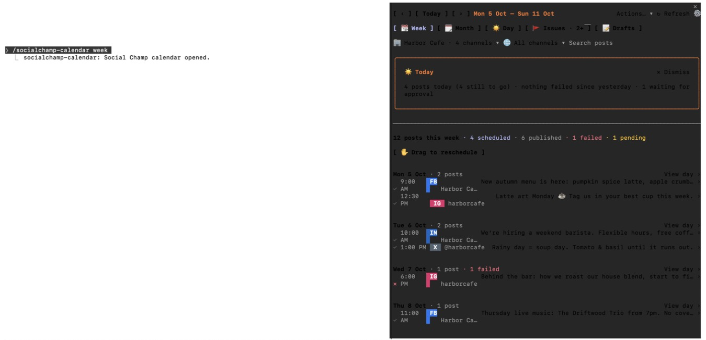
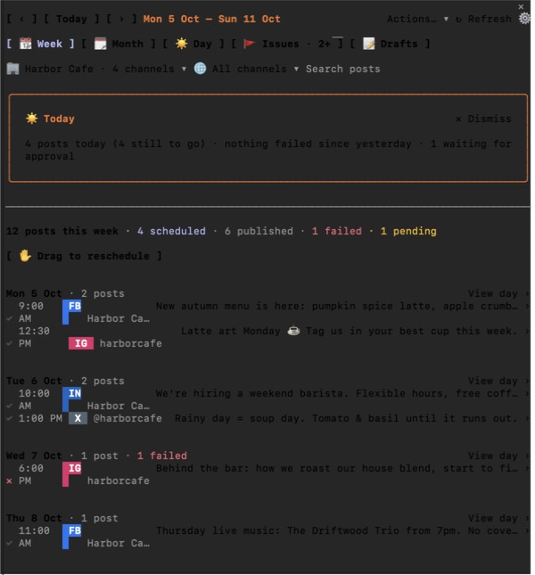
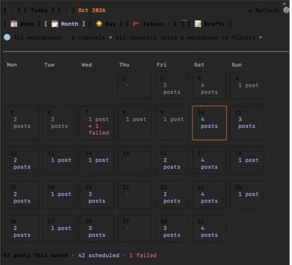
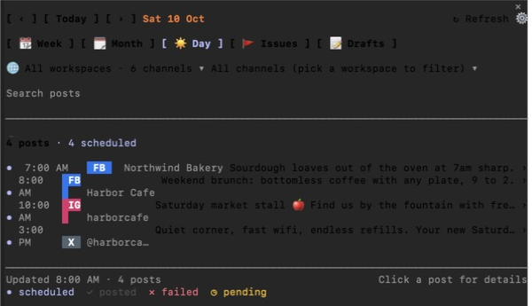
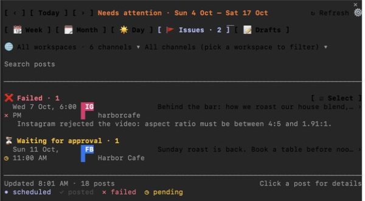
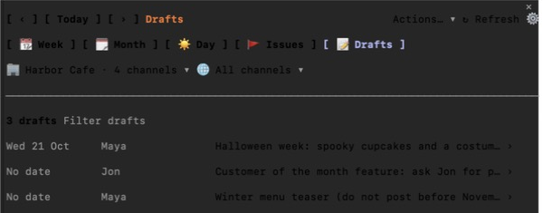

# Social Champ Calendar for Claude Code

See and manage your [Social Champ](https://www.socialchamp.com) posting calendar without leaving Claude Code,
and let Claude help plan it, without ever letting anything go out that you did not approve.



<sub>All screenshots use made-up demo data (a café called Harbor Cafe). You can open the same demo yourself:
see [Try it without an account](#try-it-without-an-account).</sub>

## Contents

- [Why use it](#why-use-it)
- [What you need](#what-you-need)
- [Set it up, step by step](#set-it-up-step-by-step)
- [Try it without an account](#try-it-without-an-account)
- [A tour of the pane](#a-tour-of-the-pane)
- [Examples](#examples)
- [How it keeps you in control](#how-it-keeps-you-in-control)
- [Auto mode: permission rules](#auto-mode-permission-rules)
- [Settings](#settings)
- [Troubleshooting](#troubleshooting)
- [Privacy: what stays on your computer](#privacy-what-stays-on-your-computer)
- [Update or remove it](#update-or-remove-it)
- [Known limitations](#known-limitations)
- [For developers](#for-developers)

## Why use it

If you schedule social posts with Social Champ and work in Claude Code, you can now do both in one place:

- **See your schedule at a glance.** Week, month and day views of every connected channel, plus an Issues view
  of failed posts and posts waiting for approval.
- **Fix things in a click.** Move a post an hour or a day, retry a failed one, edit its words, add a label,
  pause a channel, share the calendar as a link.
- **Let Claude help.** Claude can draft a week of posts and put them in the pane as a checklist, review your week,
  explain why a post failed, or write a first comment. You approve what goes in.
- **Stay safe.** Nothing reaches Social Champ until you press **✅ Yes, do it**. When Claude itself tries to change
  something from the chat, you are asked first, every time, in every permission mode.

It is a *mod* (a Claude Code plugin with a live pane), built on the
[Social Champ MCP connector](https://github.com/SocialChamp/socialchamp-mcp).

## What you need

| | |
|---|---|
| **Claude Code 2.1.293 or later** | In a terminal or in the Claude desktop app's Code tab. Check with `claude --version`; upgrade with `claude update`. Older versions do not run this mod: the pane fails to open with an error about `$.state.get`. |
| **A Social Champ account** | With at least one connected channel. Some views need you to be the workspace's owner (see [Known limitations](#known-limitations)). |
| **The Social Champ connector in Claude Code** | Step 1 below adds it. It is Social Champ's official MCP server, and you sign in through your browser. |
| **Python 3** (only for the demo) | Only to [try the demo](#try-it-without-an-account). Not needed to use the mod. |

## Set it up, step by step

### 1. Connect Social Champ to Claude Code

Run this in a terminal:

```bash
claude mcp add --scope user --transport http SocialChamp https://mcp.socialchamp.com/mcp
```

Then sign in:

1. Start Claude Code (`claude` in a terminal, or a new session in the desktop app's Code tab).
2. Type `/mcp`, choose **SocialChamp**, then **Authenticate**.
3. Your browser opens on Social Champ. Sign in and approve access.
4. Back in Claude Code, `/mcp` now shows SocialChamp as connected.

`--scope user` makes the connector available in every folder you open Claude Code in. The name `SocialChamp` is the
one the mod looks for, so nothing else needs setting.

> **Already have the connector under another name** (for example `socialchamp`)? Keep it. After step 3, run
> `/plugin configure socialchamp-calendar@socialchamp-mods` and enter the name exactly as `/mcp` lists it.

### 2. Install the mod

```bash
claude plugin marketplace add SocialChamp/socialchamp-claude-mods
```

```bash
claude plugin install socialchamp-calendar@socialchamp-mods
```

The first command adds this repository as a source of plugins. The second installs the calendar from it.

### 3. Open the calendar

In Claude Code, run `/reload-plugins` (or start a new session), then:

```
/socialchamp-calendar
```

The pane opens on this week. You should see your workspaces in the dropdown at the top and your posts listed by
day. If you see an error instead, check [Troubleshooting](#troubleshooting).

### 4. Only if you use auto mode: allow the Social Champ tools

In auto mode, Claude Code refuses the pane's calls until they are allowed. Add the
[permission rules](#auto-mode-permission-rules) **after** the pane has opened once. In the default mode you can
skip this: Claude Code asks you instead.

## Try it without an account

You can open the pane on demo data before connecting anything. It needs Claude Code 2.1.293+, Python 3 and git:

```bash
git clone https://github.com/SocialChamp/socialchamp-claude-mods.git
```

```bash
cd socialchamp-claude-mods && ./demo/try.sh
```

Add `month`, `day`, `issues` or `drafts` to open another view (`./demo/try.sh month`).

The script starts Claude Code with a small fake Social Champ server ([`demo/demo_sc.py`](demo/demo_sc.py)) as its
only connector, and runs the mod from the cloned folder. Nothing connects to Social Champ, nothing is sent
anywhere, and an installed copy of the mod keeps its own settings untouched. Changes you make in the demo only
change the demo's memory, and are gone when you quit.

## A tour of the pane

Open a view with `/socialchamp-calendar week`, `month`, `day`, `issues` or `drafts`, or with the tabs at the top
of the pane. `/socialchamp-calendar refresh` reloads from Social Champ.

### Week



- The top row moves between weeks (**‹**, **Today**, **›**).
- The dropdowns pick a workspace and a channel; **Search posts** filters by words.
- The **☀️ Today** card appears once a day: what goes out today, what failed, what is waiting for approval.
- Each post shows its time, network, channel and first words. **✓** posted, **•** scheduled, **✕** failed,
  **◷** waiting for approval.
- **✋ Drag to reschedule** lets you drag scheduled posts to another day.
- Click a post to open it; click **View day ›** to see a whole day.

### Month



Counts per day for the whole month, with failures in red. Click a day to open it.

### Day



Every post of one day. With a workspace picked, the day also has **+ New post**, **☑ Select** (several posts at
once) and **✨ Ask Claude to draft posts**.

### Issues



Everything that needs you, across two weeks: failed posts with Social Champ's reason, and posts waiting for
approval. The **🚩 Issues** tab shows how many there are, from any view.

### Drafts



The workspace's drafts, with who wrote them and when they are planned. Click one to read it, schedule it, or hand
it to Claude to polish.

### A post

Opening a post shows its full text, labels, status and links, and the things you can do with it:

- **+1 hour**, **+1 day**, or type a new time; **Retry in 15 min** for a failed post.
- Edit its words, add or remove labels, write an Instagram first comment.
- Duplicate it to another channel, recycle it into a collection, remind approvers.
- **✨ Ask Claude why it failed** / **✨ Ask Claude to review it**: Claude answers inside the pane.
- Delete it (asks first, and says it cannot be undone).

## Examples

### Move a post by an hour

1. Click a scheduled post in the week (posts already out cannot be moved).
2. Click **+1 hour**.
3. A bar appears, for example *Move "Weekend brunch…" on Harbor Cafe from Sat 8:00 AM to Sat 9:00 AM*, with a line
   saying whether it can be undone.
4. Click **✅ Yes, do it**. A *✅ Done* message appears and the pane refreshes.
5. Changed your mind? **↩ Undo** stays for two minutes.

### Retry everything that failed

1. Open **🚩 Issues**.
2. Click **☑ Select**, tick the failed posts, and click **🔁 Retry … failed**.
3. Confirm with **✅ Yes, do it**. Each post is retried a minute apart.

### Ask Claude to plan next week

Type in the chat:

> Draft five posts for Harbor Cafe for next week about our autumn menu, one a day at 9am, and stage them in the calendar.

Claude writes the posts and puts them in the pane as a checklist (nothing is scheduled yet). Untick any you do not
want, then press **✅ Yes, do it** once to schedule the rest.

### Other things to ask Claude

- *"Show me next Tuesday in the calendar."* The pane jumps there.
- *"Which channels have nothing scheduled this week?"* Claude reads what the pane shows (times, statuses, counts).
- *"Why did the Instagram post on Wednesday fail?"*
- *"Write a first comment for tomorrow's Instagram post."*

## How it keeps you in control

**In the pane**, every change shows a confirmation bar first. It says what will change, and whether and where it
can be undone: *You can undo this here*, *Undo in Social Champ: …*, *Reverse it here: …*, or *This cannot be
undone*. Before an edit or an
undo, the pane re-reads the post and stops if someone changed it in Social Champ meanwhile.

**In the chat**, the mod watches Claude's own calls to the Social Champ connector:

| Claude tries to… | What happens |
|---|---|
| Read posts, channels, drafts, labels | Allowed. |
| Change something (schedule, edit, label, pause…) | You are asked in Claude Code's question dialog, with every detail shown, and **PUBLISHES NOW** when it would go out at once. Dismissing the question refuses it. |
| Delete posts | Refused. Delete in the pane (it asks you) or in Social Champ. |
| Send more than 10 items in one call | Refused. Claude stages them in the pane instead, where you tick and confirm. |
| Read post metrics or best times | Refused. Facebook does not allow passing metrics to a third party. |

Claude also gets three tools of its own, none of which change Social Champ: `show_in_calendar` (move the pane),
`calendar_context` (ids, times, statuses and counts of what the pane shows, never post text or names) and
`stage_posts` (up to 30 checked drafts, as a checklist in the pane).

## Auto mode: permission rules

In auto mode, Claude Code refuses MCP calls it has no rule for, including the pane's. Each rule is
`mcp__<connector>__<tool>`. With the connector named as in step 1, that is `mcp__SocialChamp__<tool>`. If yours has
another name, use the name `/mcp` lists, with spaces as underscores.

Add the rules to the `permissions.allow` list in `~/.claude/settings.json`, keeping the rules already there. For
example:

```json
{
  "permissions": {
    "allow": [
      "mcp__SocialChamp__get_paginated_posts",
      "mcp__SocialChamp__update_post"
    ]
  }
}
```

The tools the pane uses:

- **Reading**: `get_paginated_posts`, `get_channels`, `get_workspaces`, `approval_list_pending`, `label_list`,
  `get_shareable_calendars`, `get_calendar_events`, `get_calendar_summary`, `get_drafts`, `get_queue_slots`,
  `get_posts_for_channels`, `list_collections`.
- **Writing words**: `generate_post`, `rewrite`, `suggest_hashtags`.
- **Changing**: `update_post`, `queue_reorder`, `label_create`, `label_apply`, `label_remove`, `queue_pause`,
  `queue_resume`, `create_public_calendar_link`, `update_shareable_calendar`, `create_text_post`,
  `create_image_post`, `generate_image`, `bulk_label`, `bulk_schedule`, `instagram_first_comment`,
  `recycle_post`, `approval_assign` (approval reminders), `approval_approve`, `approval_reject`, `delete_post`.

You can allow only the reading tools at first; a change you have not allowed is refused with a message saying so.

These rules also stop Claude Code itself asking before Claude calls those tools from the chat. The mod's own check
(above) still asks you before every change. If you uninstall the mod, remove the rules too.

## Settings

- **In the pane**, the **⚙️** button: how often the status line checks for failed posts (or off), who writes new
  posts (Claude or Social Champ AI), how many AI images a session may make, and which workspace the pane opens on.
- **Plugin options**: run `/plugin configure socialchamp-calendar@socialchamp-mods`.
  - `server`: the connector's name as `/mcp` lists it (default `SocialChamp`).
  - `pollMinutes`: how often to check today's posts for failures (default 5; 0 turns it off).

## Troubleshooting

| You see | What to do |
|---|---|
| *No Social Champ connector named "SocialChamp" is connected* | Run `/mcp`. If the connector is missing, do [step 1](#1-connect-social-champ-to-claude-code). If it is there under another name, set that name with `/plugin configure socialchamp-calendar@socialchamp-mods`. If it says it needs authentication, choose it and **Authenticate**. |
| *Loading…* for a few seconds when Claude Code starts | Normal: the pane waits for the connector to finish starting, and retries by itself. |
| The pane does not open, or an error mentions `$.state.get` | Your Claude Code is too old. Run `claude update`, then restart it. |
| *Auto mode blocked this change* | Add the [permission rules](#auto-mode-permission-rules). |
| No month counts, drafts or queue times | Those connector tools answer only for the workspace's owner. Ask the owner, or use the week and day views. |
| Approve / Reject missing | Approvals need the `manage_team` scope, which the browser sign-in does not grant. |
| `/socialchamp-calendar` is unknown | Run `/reload-plugins`, or check `claude plugin list` shows `socialchamp-calendar@socialchamp-mods` as enabled. |

## Privacy: what stays on your computer

The mod talks only to the Social Champ connector you set up, and to Claude for the writing features you use.

On your computer, in Claude Code's plugin store (`~/.claude/plugins/store/`, the `socialchamp-calendar` file), it
keeps: workspace and channel names and ids (refreshed daily, and only reused for the same connector), channels you
paused from the pane, ids of failures it already told you about, your settings and last view, and a short log of
its last 30 steps (step name, success, a count, the kind of failure). No post text, error text or links. Delete
that file to clear it.

## Update or remove it

**Update**, then run `/reload-plugins`:

```bash
claude plugin marketplace update socialchamp-mods
```

```bash
claude plugin update socialchamp-calendar@socialchamp-mods
```

**Remove**:

```bash
claude plugin uninstall socialchamp-calendar@socialchamp-mods
```

```bash
claude plugin marketplace remove socialchamp-mods
```

Then remove any `mcp__SocialChamp__…` rules you added, and delete the `socialchamp-calendar` file in
`~/.claude/plugins/store/`. To disconnect Social Champ too: `claude mcp remove SocialChamp --scope user`.

## Known limitations

- **Owner-only views**: the month summary, drafts, queue slots and calendar events answer only for a workspace's
  owner. Team members see the pane without them.
- **Approvals** need the `manage_team` scope.
- **Drafts cannot be deleted** through the connector yet (it answers success without deleting), so the pane points
  you to Social Champ for that.
- **AI image generation** can time out.
- **On the Claude phone app**, the pane uses buttons only (no text fields or dropdowns), and some panels say to open
  the desktop app.

## For developers

```bash
claude plugin validate .
```

```bash
claude plugin test .
```

- `hooks/data.ts`: pure helpers and the safety checks.
- `hooks/register.tsx`: the hooks, loaders and every write.
- `hooks/views.tsx`: the pane's drawing. It never holds `$`; handlers come bound from `register.tsx` as `act`.
- `hooks/drag.tsx`: the week's drag grid.
- `demo/`: the demo connector and `try.sh`. The screenshots in `docs/screenshots/` were taken with it.

## Licence

MIT. See [LICENSE](LICENSE).
